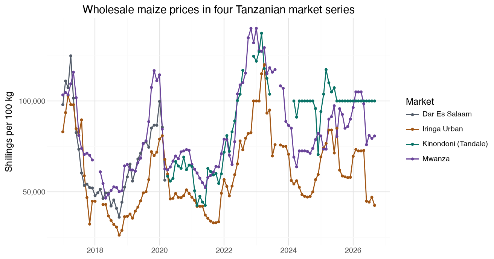

At the end of [Part 1](01-comparable-quotes.qmd#tables-for-the-first-plots), you created two dataframes, `iringa` and `recent`. Start by plotting the five monthly Iringa Urban quotes in `iringa`. Then use `recent` to compare Iringa Urban with Mwanza and Kinondoni (Tandale).

See what you can make in the [plotnine gallery](https://plotnine.org/gallery/).

```{pyodide}
#| setup: true
#| exercise: [iringa-points, practice-points, practice-labels, fixed-colour, practice-colour, iringa-line, ungrouped-line, practice-lines, practice-facets, practice-panels]
from datetime import date

import polars as pl
from plotnine import aes, facet_wrap, geom_line, geom_point, ggplot, labs, theme_minimal

from maize import maize_prices

prices = maize_prices()
recent = prices.filter(
    pl.col("month").is_between(date(2026, 1, 1), date(2026, 5, 1))
).select("month", "market", "price")
iringa = recent.filter(market="Iringa Urban")

# In Pyodide, these Parquet-derived frames raise a capacity overflow when
# plotnine converts them to pandas.
recent = pl.DataFrame(recent.to_dict(as_series=False), schema=recent.schema)
iringa = pl.DataFrame(iringa.to_dict(as_series=False), schema=iringa.schema)
```

## Data, mappings and points

Click **Show data** to see the five rows in `iringa`. Then click **Run Code** to see the same quotes as points.

```{pyodide}
#| exercise: iringa-points
#| caption: ""
#| preview: iringa
#| autorun: true
(
    ggplot(iringa, aes(x="month", y="price"))
    + geom_point()
)
```

`ggplot()` takes the data. `aes()` tells plotnine where to put each quote. The `month` column gives its horizontal position (`x`) and `price` gives its vertical position (`y`). These links between columns and the plot are called *mappings*. `+ geom_point()` adds a layer that draws one point per row. The outer parentheses let you write the plot over several lines.

### Points for three markets

::: {.task}
Look at `recent` under **Show data**. It has the same columns as `iringa` and includes all three markets. Replace each `___` with a quoted column name to plot prices over time. How many quotes do you see for January?
:::

```{pyodide}
#| exercise: practice-points
#| caption: ""
#| preview: recent
(
    ggplot(recent, aes(x=___, y=___))
    + geom_point()
)
```

::: {.solution exercise="practice-points"}
::: {.callout-tip collapse="false"}
## Solution

```{pyodide}
#| exercise: practice-points
#| solution: true
(
    ggplot(recent, aes(x="month", y="price"))
    + geom_point()
)
```

January has three points, one for each market.
:::
:::

## Axis labels

The axes start with the column names. Add `labs()` to give them labels that make sense to someone who hasn't seen the data. For example, `x="Month"` labels the horizontal axis.

::: {.task}
Fill in the vertical axis label with the currency and weight from part 1. What does a point at 100,000 mean?
:::

```{pyodide}
#| exercise: practice-labels
#| caption: ""
#| preview: recent
(
    ggplot(recent, aes(x="month", y="price"))
    + geom_point()
    + labs(x="Month", y=___)
)
```

::: {.solution exercise="practice-labels"}
::: {.callout-tip collapse="false"}
## Solution

```{pyodide}
#| exercise: practice-labels
#| solution: true
(
    ggplot(recent, aes(x="month", y="price"))
    + geom_point()
    + labs(x="Month", y="Shillings per 100 kg")
)
```

The quote was 100,000 shillings for 100 kg of maize. `labs()` leaves the points where they were.
:::
:::

## Colour by market

Run this example. `color="steelblue"` sets the colour of every point, and `size=3` makes the points bigger.

```{pyodide}
#| exercise: fixed-colour
#| caption: ""
#| preview: recent
(
    ggplot(recent, aes(x="month", y="price"))
    + geom_point(color="steelblue", size=3)
    + labs(x="Month", y="Shillings per 100 kg")
)
```

To choose colours using a column, put `color` inside `aes()`. This works like mapping a column to `x` or `y`. The plot gets a legend that tells you what each colour means.

::: {.task}
Fill in the column that gives each market its own colour. Keep the point size fixed. Use the legend to find which market's price fell from April to May.
:::

```{pyodide}
#| exercise: practice-colour
#| caption: ""
#| preview: recent
(
    ggplot(recent, aes(x="month", y="price"))
    + geom_point(aes(color=___), size=3)
    + labs(x="Month", y="Shillings per 100 kg", color="Market")
)
```

::: {.solution exercise="practice-colour"}
::: {.callout-tip collapse="false"}
## Solution

```{pyodide}
#| exercise: practice-colour
#| solution: true
(
    ggplot(recent, aes(x="month", y="price"))
    + geom_point(aes(color="market"), size=3)
    + labs(x="Month", y="Shillings per 100 kg", color="Market")
)
```

Mwanza's price fell from 105,000 to 98,500. The legend identifies Mwanza's points in both months.
:::
:::

## Lines and groups

Return to Iringa Urban. `geom_line()` connects its quotes in month order. Both layers use the `x` and `y` mappings in `ggplot()`. Place the point layer last so the dots sit on top of the line.

```{pyodide}
#| exercise: iringa-line
#| caption: ""
#| preview: iringa
(
    ggplot(iringa, aes(x="month", y="price"))
    + geom_line()
    + geom_point(size=3)
    + labs(x="Month", y="Shillings per 100 kg")
)
```

Now run the same line layer with three markets. Even though the points have different colours, a single line connects quotes from all three markets. The colour mapping belongs to `geom_point()` alone. The line layer needs its own instruction about which rows belong together.

```{pyodide}
#| exercise: ungrouped-line
#| caption: ""
#| preview: recent
(
    ggplot(recent, aes(x="month", y="price"))
    + geom_line()
    + geom_point(aes(color="market"), size=3)
    + labs(x="Month", y="Shillings per 100 kg", color="Market")
)
```

::: {.task}
Fill in `group` inside the line layer's `aes()` to draw one line per market. Which market's price stayed the same from January to May?
:::

```{pyodide}
#| exercise: practice-lines
#| caption: ""
#| preview: recent
(
    ggplot(recent, aes(x="month", y="price"))
    + geom_line(aes(group=___))
    + geom_point(aes(color="market"), size=3)
    + labs(x="Month", y="Shillings per 100 kg", color="Market")
)
```

::: {.hint exercise="practice-lines"}
::: {.callout-note collapse="false"}
## Hint

Look for the column under **Show data** that has the same value for all five quotes from Iringa Urban.
:::
:::

::: {.solution exercise="practice-lines"}
::: {.callout-tip collapse="false"}
## Solution

```{pyodide}
#| exercise: practice-lines
#| solution: true
(
    ggplot(recent, aes(x="month", y="price"))
    + geom_line(aes(group="market"))
    + geom_point(aes(color="market"), size=3)
    + labs(x="Month", y="Shillings per 100 kg", color="Market")
)
```

Kinondoni (Tandale) has a flat line at 100,000.
:::
:::

## Facets and scales

You can also give each market its own panel. `facet_wrap()` takes the name of the column that defines the panels. Each panel uses just the rows for one value in that column, so `geom_line()` can draw the line without an explicit `group` mapping here.

::: {.task}
Fill in the column name in `facet_wrap()` to put each market in its own panel. Which market's prices are lowest throughout?
:::

```{pyodide}
#| exercise: practice-facets
#| caption: ""
#| preview: recent
(
    ggplot(recent, aes(x="month", y="price"))
    + geom_line()
    + geom_point()
    + facet_wrap(___)
    + labs(x="Month", y="Shillings per 100 kg")
)
```

::: {.solution exercise="practice-facets"}
::: {.callout-tip collapse="false"}
## Solution

```{pyodide}
#| exercise: practice-facets
#| solution: true
(
    ggplot(recent, aes(x="month", y="price"))
    + geom_line()
    + geom_point()
    + facet_wrap("market")
    + labs(x="Month", y="Shillings per 100 kg")
)
```

Iringa Urban is lowest in all five months. The panels share a vertical scale by default, so the same height means the same price in each panel.
:::
:::

### Free scales (optional)

::: {.task}
Run the plot with a shared scale. Then add `scales="free_y"` to `facet_wrap()` to give each panel its own vertical scale. Which plot makes it easier to compare how much prices changed in Iringa Urban and Mwanza?
:::

```{pyodide}
#| exercise: practice-panels
#| caption: ""
#| preview: recent
(
    ggplot(recent, aes(x="month", y="price"))
    + geom_line()
    + geom_point()
    + facet_wrap("market")
    + labs(x="Month", y="Shillings per 100 kg")
    + theme_minimal()
)
```

::: {.hint exercise="practice-panels"}
::: {.callout-note collapse="false"}
## Hint

Set `scales="free_y"` in `facet_wrap()`. Check the numbers on each vertical axis.
:::
:::

::: {.solution exercise="practice-panels"}
::: {.callout-tip collapse="false"}
## Solution

```{pyodide}
#| exercise: practice-panels
#| solution: true
(
    ggplot(recent, aes(x="month", y="price"))
    + geom_line()
    + geom_point()
    + facet_wrap("market", scales="free_y")
    + labs(x="Month", y="Shillings per 100 kg")
    + theme_minimal()
)
```

A shared scale makes it easier to compare changes across markets. The same distance always means the same change in price. With free scales, small changes in one market are easier to see. Check the numbers on each axis before comparing markets.
:::
:::

## Lines across the full record

In the full record, some markets skip months. For instance, Kinondoni (Tandale) has quotes in August and December 2022 with a gap of three months between them. A line across the gap can make it look as if we know how prices changed during those months.

`plot_data()` prepares a `line` column. Its value changes each time a market's quotes resume after a gap. Under **Show data**, look at `gap` to find the two different `line` values on either side of the break in Kinondoni (Tandale).

The plot maps `color="market"` in `ggplot()`, so both the points and lines use the same colours. The `group` mapping applies only to the line layer.

```{pyodide}
#| setup: true
#| exercise: price-lines
from plotnine import aes, geom_line, geom_point, ggplot, labs, theme_minimal

from maize import maize_prices, plot_data

points = plot_data(maize_prices())
gap = points.loc[
    (points["market"] == "Kinondoni (Tandale)")
    & points["month"].between("2022-07-01", "2023-01-01"),
    ["month", "line"],
]
```

::: {.task}
Fill in the column that groups the lines without joining across gaps. Look at Kinondoni (Tandale) in late 2022. Where does the line stop and start again?
:::

```{pyodide}
#| exercise: price-lines
#| caption: ""
#| preview: [gap, points]
(
    ggplot(points, aes(x="month", y="price", color="market"))
    + geom_line(aes(group=___), size=0.7)
    + geom_point(size=1)
    + labs(x="Month", y="Shillings per 100 kg", color="Market")
    + theme_minimal()
)
```

::: {.hint exercise="price-lines"}
::: {.callout-note collapse="false"}
## Hint

Pick the column whose value stays the same only while quotes come in consecutive months in one market.
:::
:::

::: {.solution exercise="price-lines"}
::: {.callout-tip collapse="false"}
## Solution

```{pyodide}
#| exercise: price-lines
#| solution: true
(
    ggplot(points, aes(x="month", y="price", color="market"))
    + geom_line(aes(group="line"), size=0.7)
    + geom_point(size=1)
    + labs(x="Month", y="Shillings per 100 kg", color="Market")
    + theme_minimal()
)
```

{fig-alt="Maize prices in four markets from 2017 to 2026. A dot marks each quote. Lines stop at missing months. All four markets share a scale."}

The first Kinondoni (Tandale) line stops in August 2022 and the next starts in December. The colour stays the same because both runs of quotes are from the same market.

Dar Es Salaam ends in March 2020 and Kinondoni (Tandale) starts in April 2020. Keep their lines separate because the source gives them different market IDs.
:::
:::

Next, use a table to count the months with quotes and the gaps.
