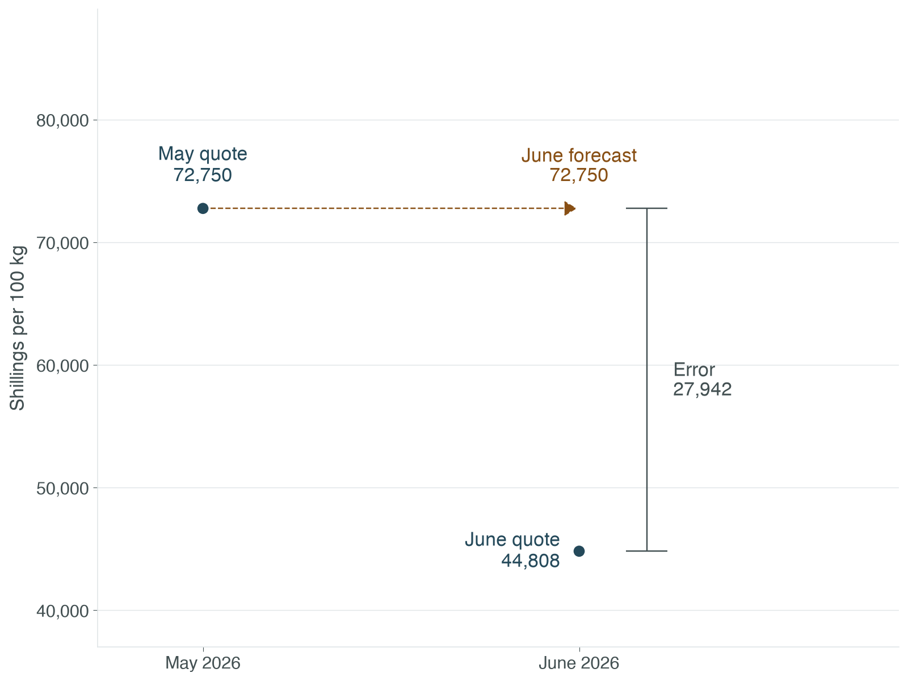
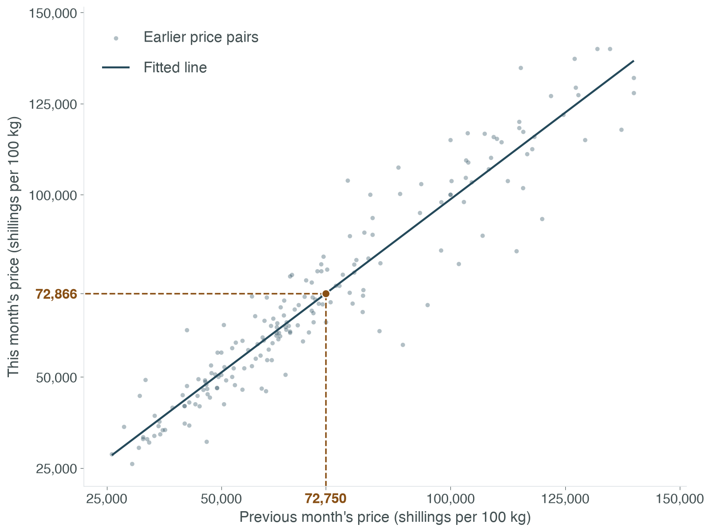

Look back at your June estimate for Iringa Urban. A simple forecast uses May's price as the June price. This is our **baseline**, the method we compare the model with.

## Previous month's price

To predict a month, we need a quote from the same market in the month just before it. `forecast_pairs()` moves each quote's date forward one month and matches it to a quote by market ID and month. If May has no quote, we skip June when we compare forecasts.

In Iringa Urban, carry May's price straight across to June. The vertical gap between that forecast and the June quote is the error.

{width=800px fig-alt="A horizontal arrow carries May's quote of 72,750 into June. The June quote is 44,808, which is 27,942 shillings per 100 kg below the forecast."}

Run the cell to calculate that gap with Python.

```{pyodide}
#| setup: true
#| exercise: [iringa-forecast, fit-regression, score-forecasts]
from datetime import date

import polars as pl
from sklearn.linear_model import LinearRegression
from sklearn.metrics import mean_absolute_error

from maize import forecast_pairs, maize_prices

pairs = forecast_pairs(maize_prices())
iringa = pairs.filter(market_id=85, month=date(2026, 6, 1))
training_pairs = pairs.filter(pl.col("month") < date(2024, 1, 1))
```

```{pyodide}
#| exercise: iringa-forecast
#| caption: ""
#| preview: iringa.select("month", "previous_price", "price")
print(iringa.select("previous_price", "price"))
miss = abs(iringa["previous_price"][0] - iringa["price"][0])
print(f"Baseline miss: {miss:,.0f}")
```

## Linear regression

Each dot below shows two prices in the same market, one month apart. Find last month's price on the horizontal axis and the recorded price for the following month on the vertical axis. We use pairs from before January 2024 to fit the model. These pairs are the **training data**.

**Linear regression** fits a straight line to these dots. It chooses the line's tilt and height to keep the vertical gaps between the dots and the line small. To forecast June 2026, start at May's price of 72,750. Go up to the line, then across to read the forecast of 72,866.

{width=800px fig-alt="A scatter plot of earlier price pairs with a fitted line. A guide goes up from the May 2026 price of 72,750 to the line, then left to the June forecast of 72,866. Both axes use shillings per 100 kg."}

Run the cell to make the same forecast. `fit()` learns the line from the earlier price pairs. `predict()` reads the forecast from that line using May's price.

```{pyodide}
#| exercise: fit-regression
#| caption: ""
#| preview: training_pairs.select("market", "month", "previous_price", "price")
model = LinearRegression()
model.fit(training_pairs.select("previous_price"), training_pairs["price"])
june_forecast = model.predict(iringa.select("previous_price"))
print(f"June forecast: {june_forecast[0]:,.0f}")
```

## Training and evaluation

Test both methods on the same rows from January 2024 onwards. Three markets have data in this period. Keep the trained model fixed and use the last month's recorded price for each forecast.

`mean_absolute_error()` measures how far each forecast is from the recorded price and takes the average. This is the **mean absolute error** (MAE), in shillings per 100 kg.

## Cutoff exercise

::: {.task}
1. Run the cell with the cutoff at January 2024. Write down the number of test rows and both errors.
2. Change the cutoff to January 2025. Run the cell again and write down what changed.
3. Choose a method for these markets. What changed in the test data? How does that affect what you can say about the model?
:::

```{pyodide}
#| exercise: score-forecasts
#| caption: ""
#| preview: pairs.select("month", "market", "previous_price", "price")
cutoff = date(2024, 1, 1)
train = pairs.filter(pl.col("month") < cutoff)
test = pairs.filter(pl.col("month") >= cutoff)

model = LinearRegression()
model.fit(train.select("previous_price"), train["price"])
baseline = test["previous_price"]
regression = model.predict(test.select("previous_price"))

baseline_mae = mean_absolute_error(test["price"], baseline)
regression_mae = mean_absolute_error(test["price"], regression)
print(f"{train.height} training pairs, {test.height} test pairs")
print("Mean absolute error")
print(f"Previous month: {baseline_mae:,.0f}")
print(f"Linear regression: {regression_mae:,.0f}")
```

::: {.hint exercise="score-forecasts"}
::: {.callout-note collapse="false"}
## Hint

Set `cutoff = date(2025, 1, 1)`. Which rows move from `test` to `train`?
:::
:::

::: {.solution exercise="score-forecasts"}
::: {.callout-tip collapse="false"}
## Solution

Change the first line to `cutoff = date(2025, 1, 1)`.

| First possible test month | Training pairs | Test pairs | Previous month MAE | Linear regression MAE |
|---|---:|---:|---:|---:|
| January 2024 | 190 | 96 | 4,878 | 5,109 |
| January 2025 | 223 | 63 | 5,257 | 5,648 |

The baseline has the lower error in both runs. The table rounds errors to the nearest shilling. Moving the cutoff adds training rows and changes the test months. To compare two versions of the model fairly, train them before the same cutoff and score them on the same test rows.

:::
:::

## Forecast decision

Click **Start Over**, then **Run Code** to test from January 2024 again. The plot shows how far each forecast was from the recorded price. Look at Iringa Urban in June 2026. Did either method come close to the June price?

:::: {.mx-auto}
::: {.forecast-error-plot role="img" aria-label="Forecast errors by month in three markets from January 2024. Both methods have a large error in Iringa Urban in June 2026."}

```{pyodide}
#| echo: false
from datetime import date

import polars as pl
from plotnine import (
    aes,
    element_text,
    facet_wrap,
    geom_point,
    ggplot,
    labs,
    scale_color_manual,
    scale_x_datetime,
    scale_y_continuous,
    theme,
    theme_minimal,
)
from sklearn.linear_model import LinearRegression

from maize import forecast_pairs, maize_prices

pairs = forecast_pairs(maize_prices())
cutoff = date(2024, 1, 1)
train = pairs.filter(pl.col("month") < cutoff)
test = pairs.filter(pl.col("month") >= cutoff)
model = LinearRegression().fit(train.select("previous_price"), train["price"])
regression = model.predict(test.select("previous_price"))

errors = (
    test.with_columns(regression=regression)
    .select(
        "market",
        pl.col("month").cast(pl.Datetime),
        **{
            "Previous month": (pl.col("previous_price") - pl.col("price")).abs(),
            "Linear regression": (pl.col("regression") - pl.col("price")).abs(),
        },
    )
    .unpivot(index=["market", "month"], variable_name="method", value_name="abs_error")
)

(
    ggplot(errors, aes("month", "abs_error", color="method", shape="method"))
    + geom_point(alpha=0.8, size=1.4)
    + facet_wrap("market", nrow=1)
    + scale_color_manual(
        values={"Previous month": "#087266", "Linear regression": "#a15513"}
    )
    + scale_x_datetime(date_breaks="6 months", date_labels="%b '%y")
    + scale_y_continuous(labels=lambda values: [f"{value:,.0f}" for value in values])
    + labs(
        x="",
        y="Absolute error (shillings per 100 kg)",
        color="Method",
        shape="Method",
        title="Forecast errors vary by market and month",
    )
    + theme_minimal()
    + theme(
        figure_size=(10.5, 6.5),
        dpi=100,
        legend_position="bottom",
        panel_spacing=.025,
        title=element_text(margin={"b": 15},),
        axis_text=element_text(size=8)
    )
)
```

:::

::: {.figure-caption}
Forecast errors in three markets from January 2024. The baseline was off by 27,942 in Iringa Urban in June 2026.
:::
::::

Write a short answer. Name the method you would use and give a score to explain your choice. Include the markets, dates and price unit.

::: {.callout-note collapse="true"}
## Example conclusion

I would use last month's price for Iringa Urban, Mwanza and Kinondoni (Tandale). From January 2024 to September 2026, its average error was 4,878 shillings per 100 kg. Linear regression had an average error of 5,109.

The scores use recorded wholesale prices without adjusting for inflation. They cover months in these three markets that had a quote the month before. Either method could give different results for retail prices, other markets or future months.

:::
