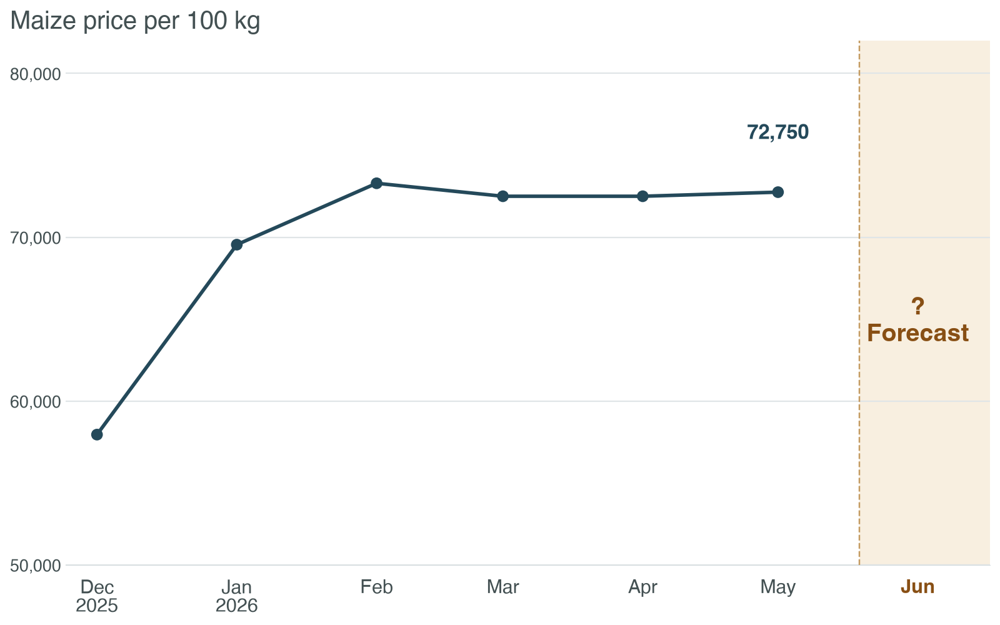

::: {.workshop-intro}
**What will 100 kg of maize cost at Iringa Urban in June 2026?** Imagine it is the end of May. The chart shows six months of wholesale prices, the prices for bulk sales. We call each recorded price a *quote*. Prices are in Tanzanian shillings (TZS).
:::

{width=800px fig-alt="Wholesale maize prices at Iringa Urban in shillings per 100 kg. December 2025 was 57,950. From January to May 2026, prices were 69,545, 73,292, 72,500, 72,500 and 72,750. June is marked as the forecast month." fig-align="center"}

Write down your estimate and give one reason. In [part 4](04-one-month-forecasts.qmd), you'll check your estimate against the June quote and test two ways to predict prices.

## Browser setup

Use a modern browser with an internet connection. Wait for Python to load when you open each part.

1. Click **Show data**. Use the menu to switch between `sample` and `quotes`.
2. Click **Run Code**. You can edit the code and run it again. Click **Start Over** to get the original code back.
3. Use **Show Hint** or **Show Solution** where available.

```{pyodide}
#| setup: true
#| exercise: preview-quotes
import polars as pl

quotes = pl.read_parquet("data/market_quotes.parquet", use_pyarrow=True)
sample = quotes.select("date", "market", "commodity", "unit", "price")
```

```{pyodide}
#| exercise: preview-quotes
#| caption: ""
#| preview: [sample, quotes]
print(f"{quotes.height:,} quotes")
print(sample.head(3))
```

Check that you see **2,025 quotes** and three sample rows. If Python fails to load, check your connection and reload the page.

## Workshop parts

```{=html}
<div class="workshop-route">
  <a href="01-comparable-quotes.html">
    <span class="route-number"><span class="visually-hidden">Part </span>01</span>
    <span class="route-title">Comparable quotes</span>
    <span class="route-description">Choose prices you can compare.</span>
    
    <span class="route-tool">Polars</span>
  </a>
  <a href="02-prices-over-time.html">
    <span class="route-number"><span class="visually-hidden">Part </span>02</span>
    <span class="route-title">Prices over time</span>
    <span class="route-description">Draw price trends and show missing months.</span>
    
    <span class="route-tool">plotnine</span>
  </a>
  <a href="03-market-coverage.html">
    <span class="route-number"><span class="visually-hidden">Part </span>03</span>
    <span class="route-title">Market coverage</span>
    <span class="route-description">Make a table of months with and without prices.</span>
    
    <span class="route-tool">Great Tables</span>
  </a>
  <a href="04-one-month-forecasts.html">
    <span class="route-number"><span class="visually-hidden">Part </span>04</span>
    <span class="route-title">One-month forecasts</span>
    <span class="route-description">Compare a model with a forecast based on last month's price.</span>
    
    <span class="route-tool">scikit-learn</span>
  </a>
</div>
```

You'll use basic Python variables, functions and imports.

## Data source

We use part of the World Food Programme’s *United Republic of Tanzania – Food Prices* dataset. [Market quotes (Parquet)](data/market_quotes.parquet) · [Data dictionary](data/data-dict.yaml) · [WFP dataset on HDX](https://data.humdata.org/dataset/wfp-food-prices-for-united-republic-of-tanzania) · [CC BY 3.0 IGO](https://creativecommons.org/licenses/by/3.0/igo/)
